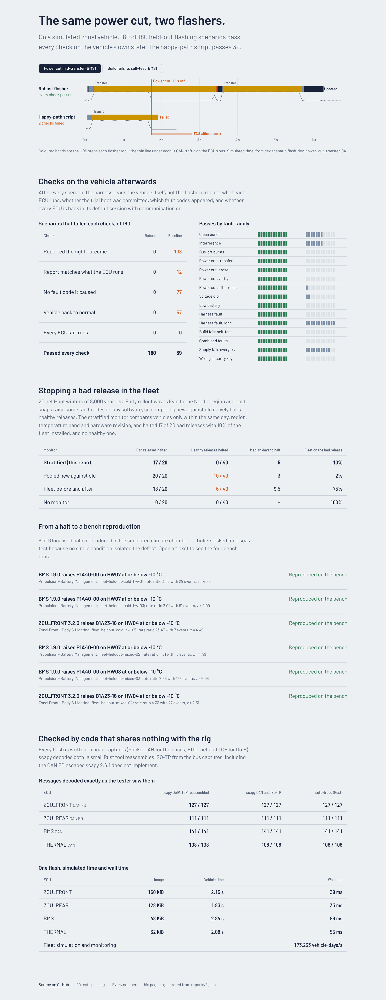

# sdv-integration-rig

A simulated zonal vehicle to integrate against: a central gateway on DoIP, two CAN FD zone buses and a
classic CAN powertrain bus, and four ECUs. Each ECU has a bootloader with A/B slots, SecurityAccess,
fault memory and its own timing. ISO-TP (ISO 15765-2), UDS (ISO 14229) and DoIP (ISO 13400-2) are
written from the standards in plain Python. Every byte that crosses a wire can be written to a pcap file
and decoded by tools that share no code with the rig.

On top of that vehicle sit three pieces of integration work:

- **Flashing that survives the field.** A robust flasher rides out power cuts at every stage, brown-outs,
  bus-off bursts, harness faults and builds that fail their self-test. Before it starts, it quiets the
  whole vehicle (DTC setting off, communication off, kept alive by a functional TesterPresent), so a
  flash leaves no fault codes on the neighbouring ECUs. It is scored against the happy-path script most
  flashing tools start as. The harness checks the vehicle's own state after every run, never the
  flasher's report.
- **Fleet monitoring that stops a bad rollout.** A synthetic fleet of 8,000 vehicles goes through a
  winter of staged over-the-air rollouts. The confounders are the ones that fool a dashboard: early
  waves lean to the Nordic region, cold snaps raise some fault codes on any software, and some defects
  show only on one hardware revision below a temperature. A stratified monitor decides from the vehicle
  uploads alone whether to halt.
- **Triage that ends on the bench.** When the monitor halts a release, it localises the excess (which
  hardware revision, below which temperature). The release is then flashed onto the bench vehicle with
  that hardware, in a simulated climate chamber, with controls. The result is a ticket for the owning
  team that says whether the bench reproduced the field finding.

## Dashboard

Generated by `python -m sdvrig report` from `reports/*.json`; nothing between the markers is typed by
hand.

<!-- dashboard:start -->
**Flashing under faults** — 180 held-out scenarios in 15 fault families, run once (locked by SHA-256 before the first run):

| Check, on the vehicle's own state | Robust flasher | Happy-path baseline |
|---|---:|---:|
| Scenarios passing every check | **180 / 180** | 39 / 180 |
| Reported the wrong outcome | 0 | 108 |
| Report disagreed with what the ECU runs | 0 | 12 |
| Left a fault code the scenario did not cause | 0 | 77 |
| Left an ECU outside the default session or muted | 0 | 57 |
| Bricked ECUs | 0 | 0 |
| Blocks repeated / programming restarts | 219 / 89 | 0 / 0 |

**Fleet monitoring** — 20 held-out fleets of 8,000 vehicles over 45 winter days, 20 bad releases and 40 healthy ones, staged rollouts that halt when the monitor says so:

| Monitor | Bad releases halted | Healthy releases halted | Median days to halt | Median fleet share on the bad release | Bad-release vehicle-days avoided |
|---|---:|---:|---:|---:|---:|
| **Stratified (this repo)** | 17 / 20 | 0 / 40 | 5 | 10% | 87% |
| Pooled new vs old | 20 / 20 | 10 / 40 | 3 | 2% | 97% |
| Fleet before/after | 18 / 20 | 6 / 40 | 9.5 | 75% | 22% |
| No monitor | 0 / 20 | 0 / 40 | – | 100% | 0% |

Triage after a halt: the localisation (hardware revision and temperature) was right for 16 of 17 halts; 6 of 6 bench reproductions in the simulated climate chamber confirmed the fleet finding; 11 tickets asked for a soak test because no single condition isolated the defect.

**Independent decoders** — 487 diagnostic messages from four flashes (18,045 CAN and CAN FD frames) decoded from the pcap captures by code that shares nothing with the rig: doip/scapy 487 / 487, isotp/scapy 487 / 487, isotp/rust 487 / 487.

| ECU | Bus | Image | Flash, simulated | Effective rate | Wall time |
|---|---|---:|---:|---:|---:|
| ZCU_FRONT | zone-front (CAN FD 2 Mbit/s) | 160 KiB | 2.15 s | 74.4 KiB/s | 39 ms |
| ZCU_REAR | zone-rear (CAN FD 2 Mbit/s) | 128 KiB | 1.83 s | 69.8 KiB/s | 32 ms |
| BMS | powertrain (CAN 500 kbit/s) | 48 KiB | 2.84 s | 16.9 KiB/s | 89 ms |
| THERMAL | powertrain (CAN 500 kbit/s) | 32 KiB | 2.08 s | 15.4 KiB/s | 55 ms |

Fleet simulation and monitoring: 173,233 vehicle-days per second (Python 3.13.16). Tests: 99 passed, 0 failed, 0 skipped.
<!-- dashboard:end -->



The web dashboard (`web/`, React and Framer Motion) draws a flash timeline from the run data. It shows
the same power cut hitting both flashers, the checks by fault family, the fleet monitors side by side,
and every ticket with its four bench runs.

## How it fits together

```
 tester ──DoIP/TCP 13400──► CGW gateway ──ISO-TP──► zone-front  (CAN FD 2 Mbit/s)  ZCU_FRONT
   ▲      routing activation,            functional    zone-rear   (CAN FD 2 Mbit/s)  ZCU_REAR
   │      ACK/NACK, vehicle id           0x7DF         powertrain  (CAN 500 kbit/s)   BMS ◄─status─► THERMAL
   │
 flashers (robust, baseline) ── only through the tester
   ▲
 scenario harness ── injects faults at a step or block, then checks the vehicle itself
                                                              │
 captures (pcap) ──► scapy DoIP, scapy ISO-TP, isotp-trace (Rust) ─► must equal the tester's log

 fleet world (truth) ──VehicleDay uploads──► monitor (stratified / pooled / before-after) ──halts──► rollout
                                                   │
                                                   └─ localisation ──► triage on the bench vehicle ──► ticket
```

| Path | What it is |
|---|---|
| `sdvrig/sim` | Discrete-event clock in integer microseconds; a 3 s flash runs in about 50 ms of wall time |
| `sdvrig/can` | CAN and CAN FD buses: arbitration, bit timing with stuffing, error frames with retransmission, frame loss |
| `sdvrig/isotp` | Segmentation, flow control, block size, STmin, N_Bs/N_Cr timeouts, CAN FD escapes for single and first frames |
| `sdvrig/uds` | Sessions, S3, response pending (0x78), suppressed responses, functional rules, seed and key |
| `sdvrig/vehicle` | ECUs with A/B bootloader, trial boot and commit, self-test, DTCs, comm-loss monitors; the tester; fault injection |
| `sdvrig/doip` | Message codec, the gateway, and a real TCP/UDP server any DoIP client can drive |
| `sdvrig/flash` | Image builder, robust and baseline flashers |
| `sdvrig/scenarios` | Fault-scenario generator, runner and the five vehicle checks |
| `sdvrig/capture` | pcap writer (SocketCAN 227, Ethernet/IPv4/TCP) and the independent cross-check |
| `sdvrig/fleet` | Fleet world (the truth), monitors, scoring, bench triage |
| `tools/isotp-trace` | Rust, no dependencies: reassembles ISO-TP from a SocketCAN pcap |
| `config/` | Every timing, threshold and policy: `rig.json`, `vehicle.json`, `flash.json`, `fleet.json`, `heldout.lock` |

## Run it

```bash
pip install pytest scapy==2.6.1
(cd tools/isotp-trace && cargo build --release)      # the Rust decoder for the cross-check

python -m pytest -m "not slow"                        # fast suite
python -m sdvrig flash-eval --set dev                 # 150 flashing scenarios, both flashers
python -m sdvrig fleet-eval --set dev                 # 8 fleets, every monitor, bench triage
python -m sdvrig crosscheck                           # captures checked by scapy and the Rust tool
python -m sdvrig serve --port 13400                   # the vehicle on a real DoIP port
python -m sdvrig report                               # REPORT.md, this dashboard, web/public/data.json

cd web && npm ci && npm run dev                       # the dashboard
```

With `serve` running, any DoIP tester works. For example, with scapy:

```python
from scapy.contrib.automotive.doip import UDS_DoIPSocket
from scapy.contrib.automotive.uds import UDS, UDS_RDBI
s = UDS_DoIPSocket(ip="127.0.0.1", port=13400, source_address=0x0E80, target_address=0x1B01)
s.sr1(UDS() / UDS_RDBI(identifiers=[0xF190]))      # VIN from the BMS
```

## Held-out rule

The flashing and fleet scenarios come from seeded generators. The dev sets (`scenarios/*_dev.json`)
were used while building and tuning. The held-out sets were generated with other seeds, locked by
SHA-256 in `config/heldout.lock` before anything ran on them, and run once after the flasher and the
monitor were frozen. Their first runs are in `reports/heldout/` and are the numbers above. The CLI
refuses a second held-out run unless asked, and writes it to a separate file.

## Limits

- **A simulation, not a vehicle.** Timings follow the defaults in the standards and plausible ECU figures
  (`config/rig.json`, `config/vehicle.json`). There is no hardware in the loop. The CAN error model is
  error frames with retransmission plus loss windows for bus-off; there are no error counters or
  error-passive state.
- **Protocol coverage is what flashing and fault reading need.**
  - ISO-TP uses normal addressing with 11-bit identifiers.
  - UDS covers the services listed in `sdvrig/uds`. The seed and key is an HMAC test algorithm, not any
    manufacturer's.
  - DoIP has one tester socket, no TLS and no entity-status or power-mode messages.
- **One gap in the robust flasher.** It re-quiets the vehicle after the target's own reboots, but not
  when a *neighbouring* ECU reboots mid-flash. That neighbour can log a comm-loss code. No scenario
  family covers this yet.
- **The fleet is synthetic, and so are its defects and confounders.** On the held-out fleets the
  stratified monitor missed 3 of 20 bad releases. All 3 were cold-only defects at low rates. It also
  halts later than the pooled comparison: a median of 5 days against 3. That delay is the price of
  halting no healthy release, where the pooled comparison halted 10 of 40.
- **A rate-only defect has no bench reproduction.** When a defect raises a rate at every temperature,
  triage asks for a soak test instead of a bench repro.
- **A gap in scapy, not in the rig.** scapy 2.6.1's ISO-TP builder does not implement the CAN FD
  single-frame escape. Those messages are checked at the frame level, and the Rust decoder covers them
  fully.

## Licence

MIT. Addresses, part numbers, DTC meanings outside SAE J2012's generic codes, and security secrets are
invented test values and belong to no real vehicle.
